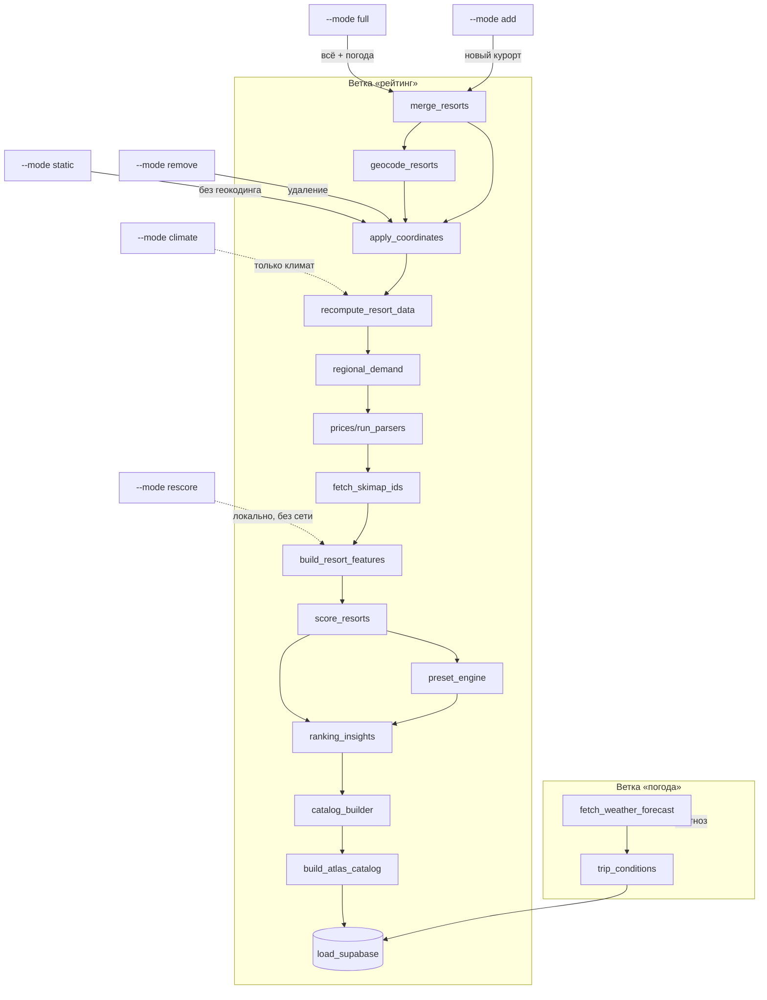

# Travel Designer (SKI ATLAS)

> Техническая «библия» проекта: архитектура данных, пайплайн, источники, витрины, методика и структура BI-дашборда.
> Единый источник правды по проекту — документация для аналитиков, разработчиков и дашборда.
>
> Подробный контекст (источники, каскады сбора, инкрементальность, отличия от ТЗ) — в **[docs/PROJECT_CONTEXT.md](docs/PROJECT_CONTEXT.md)**.

---

## Скриншоты дашборда

### Страница 1 — «Атлас и рейтинги»


### Страница 2 — «Атлас сравнение — факты и прогноз»


---

## 1. Архитектура дашборда (Ski Atlas)

### Общее назначение

**Ski Atlas** — воспроизводимый композитный рейтинг **32 горнолыжных курортов в 20 регионах РФ** для приоритизации подключения к каталогу Travel Designer. Поскольку прямой сопоставимой статистики посещаемости по конкретным курортам в открытом доступе нет, рейтинг собирается из открытых источников: региональный турпоток, инфраструктура (OSM), климат (ERA5), аэропорт, цены.

**Ключевая идея:** не «правильный ответ», а **объяснимый и воспроизводимый инструмент** с прозрачными весами, ограничениями и оценкой уверенности в данных.

### Для кого

| Аудитория | Что получает |
|---|---|
| **Команда Travel Designer / продакт** | Приоритезация подключения курортов, обоснование решения, готовые сценарии каталога (N=5/8/10/12) |
| **Аналитик / разработчик** | Воспроизводимый расчёт: 13 показателей → 5 компонентов → индекс, оценка уверенности, устойчивость через Monte Carlo, drill-down до сырых фактов |
| **Лыжник / сноубордист** | Сравнение курортов по характеристикам, прогноз глубины снега и температуры на 10 дней, предпосылки состояния трасс |

### Общая архитектура данных

Пайплайн `run_pipeline.py` собирает данные из открытых источников в слои **RAW → Prepared → Mart** и загружает 13 витрин в Supabase. Дашборд работает на четырёх основных датасетах:

| Датасет | Гранулярность | Что содержит |
|---|---|---|
| `atlas_catalog` | курорт × сценарий (732 строки) | Все сценарии (6 пресетов × {all_top, all_diversity, top_nN, diversity_nN}), 5 компонентов + 5 вкладов + 5 весов + сырые факты |
| `atlas_summary` | курорт (32 строки) | Базовый срез (preset=base) + 13 сырых баллов + 13 вкладов + климат + ссылки + strengths/weaknesses |
| `v_index_breakdown` | курорт × показатель (416 строк) | Long-format разбивка индекса для stacked bar / treemap |
| `v_ranking_stability` | курорт × сценарий (732 строки) | `atlas_catalog` + метрики устойчивости из `ranking_stability` (median_rank, rank_p5/p95, top10_frequency, local_score) |

### Страница 1. «Атлас и рейтинги — какой горнолыжный курорт выбрать первым»

**Вопрос страницы:** какие курорты лидируют, за счёт чего, насколько устойчиво и насколько уверенно.

**Шапка:** заголовок «Ski Atlas: атлас и рейтинг»; источники (Wikipedia · Wikidata · OpenSkiMap · OSM/Overpass · ERA5 · Open-Meteo · OurAirports · Росстат/ЕМИСС · цены); индекс (модельная оценка потенциала, базовый каталог 40/25/20/10/5, 13 → 5 компонентов); контекстная панель (Handlebars) с пресетом, описанием, стратегией и N — обновляется с фильтрами.

**1. Карта 32 курортов** — «где находятся курорты». Цвет точки = индекс, размер = уверенность. Tooltip: название, регион, индекс, ссылки (официальный сайт / Вики / схема трасс). Видны кластеры: Краснодарский край (Роза Хутор, Красная Поляна, Газпром Поляна), Приэльбрусье (Эльбрус, Чегет), Мурманская область (Большой Вудъявр, Кукисвумчорр, КолаСпортЛэнд), Урал, Сибирь, Дальний Восток.

**2. KPI-карточки** — число курортов в сценарии, число регионов, курорты с ценой, средний индекс, доля с подтверждёнными координатами.

**2.5 «Выбор пресета: что важнее» (бары по пресетам)** — ключевой интерактивный элемент под KPI-карточками. 6 пресетов по Y, 100% ширины по X, внутри каждого бара 5 цветных сегментов (Спрос `#46767E`, Инфраструктура `#2E5A5E`, Зима `#93B9C6`, Доступность `#5E8FA0`, Цена `#B79B72`), ширина = вес компонента. Показывает, что «переключение пресета» — это другая расстановка приоритетов (в «Цена» цена 40% — и лидеры меняются: КолаСпортЛэнд, Евразия, Красная Глинка вместо Розы Хутор). Связан с таблицей скоринга — вклады в строке = проценты в баре.

**3. Горизонтальный рейтинг (топ-12)** — базовый рейтинг с разложением на 5 компонентов (stacked bar). Раскраска `label_colors`. Реагирует на пресет/стратегию/N.

**4. Пузырьковая диаграмма «влияние региона»** — X = региональный вклад, Y = индекс, размер = инфраструктурный балл. Видно «инфраструктурных лидеров в богатых регионах» vs «слабый регион + слабая инфраструктура».

**5. Monte Carlo устойчивости** — 5000 прогонов, шум ×U(0.6, 1.4) вокруг весов пресета, перенормировка к 100. Метрики `median_rank`, `rank_p5`, `rank_p95`, `top10_frequency`. Источник — `v_ranking_stability` (фильтруется по стратегии и N).

**6. Интерактивная таблица скоринга (Handlebars)** — drill-down «компонент → факты». Свёрнутый вид → 5 компонентов → факты (поездки/рост/ночёвки, трассы/подъёмники/размещение/питание, снег/мороз/снегопад/температура, аэропорт/транспорт, цена). Скролл `max-height:75vh; overflow-y:auto`. 5 цветных полос из `label_colors`. Реагирует на фильтры.

**7. Блок «Ограничения интерпретации»** — «Что видно» / «Данные» / «Модель» (координаты из OpenSkiMap с пересечением радиуса 6 км; индекс ≠ посещаемость, регион ≠ курорт; Monte Carlo на полном пресете; OSM = полнота картирования; ERA5 ~25 км с поправкой на высоту; цена не у всех — нейтральные 50; Min-max зависит от выборки; веса — гипотеза).

**Фильтры (native filters):**

| Фильтр | Поле | Значения | Что меняет |
|---|---|---|---|
| Пресет рейтинга | `preset_name_ru` | Базовый каталог / Баланс / Инфра / Снег / Доступ / Цена | Индекс и место по другой весовой схеме |
| Стратегия выбора | `strategy_name_ru` | Топ по индексу / Региональное разнообразие / Разнообразие + подтверждённые | Состав (top концентрируется, diversity ≤1 курорта на регион) |
| Размер выборки | `size_label` | 5 / 8 / 10 / 12 / Все | Сколько курортов показывать |

Default: Базовый каталог / Топ по индексу / Все → полный рейтинг 32 курортов по базовой модели.

### Страница 2. «Атлас сравнение — факты и прогноз»

**Вопрос страницы:** чем отличаются выбранные курорты, что проверить, стоит ли ехать.

**Шапка:** «Ski Atlas: сравнение и прогноз»; источники + Skimap (схемы трасс); индекс (базовый каталог 40/25/20/10/5 · 13 → 5 компонентов · сравнение по выбранным курортам).

**Фильтры:** Ski Resort A/B/C (`name_ru`), default Роза Хутор / Домбай / Шерегеш.

**1. Три карточки-паспорта курортов (Handlebars, ID 86/93/94)** — название, регион, индекс, место; цена (₽) + тип продукта; климат (30-летняя норма); аэропорт (IATA + км); высоты (min/max, перепад) + длина трасс + подъёмники; сложность по категориям (цветные бейджи); инфраструктура OSM (отели/кафе/развлечения/транспорт); сноупарк/беговые (флаги); кнопки Вики/Сайт/Схема трасс.

**2. Три таблицы баллов (ID 87/88/89)** — 13 показателей → 5 компонентов → индекс, вклад и вес каждого; подсветка ячеек по значению (высокий/средний/низкий).

**3. Среднемесячный климат (ID 90/91/92)** — историческая норма 30 сезонов (ERA5, ноябрь–апрель), с поправкой на среднюю высоту склона ((низ + верх) / 2).

**4. Прогноз погоды 7–10 дней (ID 95/96/97)** — матрица «курорт × дата»: температура, осадки, снегопад, ветер (Open-Meteo Forecast API).

**5. «Погода для катания — ехать или нет» (ID 98/99/100)** — график на 10 дней: min/max температура, толщина снега (snow depth), снегопад по дням. Позволяет сравнить, где покров стабильно 80 см, а где 15 см с риском проталин. Ограничение: модельные предпосылки, не подтверждённое состояние трасс (оснежение, ратраки, лавины, ветер не учитываются).

**6. Ограничения и допущения** — «Что видно» / «Данные» / «Модель» (вклады = вес × балл, сумма ±0.1 из-за округления; климат — норма, не прогноз; точность прогноза падает с горизонтом; индекс ≠ посещаемость; Min-max зависит от выборки).

### Сквозная интерактивность

| Что | Как работает |
|---|---|
| Native filters | 3 фильтра на стр. 1 + 3 на стр. 2; по страницам независимы (фильтры стр. 1 не влияют на стр. 2) |
| Drill-down | Только в Handlebars-таблице скоринга (стр. 1): курорт → 5 компонентов → факты |
| Tooltip | Карта (ссылки), бары (значения), bubble (компоненты) |
| Cross-filter | Отключён (`cross_filters_enabled: false`) |
| CSS изоляция | CSS дашборда не проникает внутрь Handlebars — только inline-стили |

### Визуальная система

- Фон `#0a1418` (тёмный); палитра: бирюза `#93B9C6` (заголовки), золотой `#B79B72` (акценты/цена), 5 цветов компонентов (`label_colors`).
- Единая схема между чартами (`label_colors`) и Handlebars (inline `style`).

### Что показывает дашборд разным аудиториям

- **Команда Travel Designer:** какой курорт подключать первым (рейтинг + устойчивость + уверенность), что предложить покупателю (стр. 2, сравнение по фактам), какие данные подтянуть (блок «Ограничения»).
- **Аналитик/разработчик:** воспроизводимость (`--mode rescore`, бит-в-бит), прозрачность (13→5→индекс, веса в `scoring_weights.json`/`scoring_presets.json`), расширяемость (`resorts_manual.json`), drill-down = «живой отчёт».
- **Лыжник/сноубордист:** «где кататься» (стр. 2 карточки), «когда ехать» (климат + прогноз), «стоит ли ехать» (снегопад + толщина снега). Дашборд не учитывает оснежение, лавины, закрытие подъёмников, время трансфера — это честно указано в «Ограничениях».

### Технические детали реализации

| Что | Как |
|---|---|
| Хостинг дашборда | Preset Cloud, workspace `Urizen-Data`, план Starter |
| БД | Supabase PostgreSQL, `aws-0-eu-west-1.pooler.supabase.com` |
| CSS | `label_colors` в JSON Metadata + inline-стили в Handlebars + CSS дашборда для контейнеров |
| Пайплайн | `python run_pipeline.py --mode rescore` — пересчёт + загрузка в Supabase |
| Округление | 1 знак — баллы, 2 — ночей на поездку, 3 — рост, 0 — целые (поездки, ранги, OSM-объекты) |
| View устойчивости | `v_ranking_stability` = `atlas_catalog` ⋈ `ranking_stability` по `resort_id + preset_id` — фильтрует устойчивость по стратегии и N |

### Что НЕ обещает дашборд

- Фактическую посещаемость каждого курорта (только региональный прокси)
- Универсальный ответ «где лучше кататься» для любого человека
- Состояние открытых трасс и подъёмников в реальном времени
- Полный бюджет поездки, время трансфера по дороге
- Персональную рекомендацию по уровню катания

---

## 2. О проекте и продуктовые границы

**Цель:** рейтинг горнолыжных курортов России + данные для дашборда Travel Designer (платформа-конструктор поездок «ски-атлас»).

**Главный вопрос проекта:** какие горнолыжные курорты первыми включить в каталог Travel Designer и почему?

**Цепочка сторителлинга (User Journey):**
Дашборд должен провести пользователя по цепочке:
1. **Где** находятся курорты (Карта).
2. **Кто** лидирует в базовой модели (Рейтинг).
3. **За счёт чего** формируется результат (Вклады компонентов).
4. **Насколько** результат устойчив (Монте-Карло).
5. **Чем** отличаются выбранные варианты (Сравнение).
6. **Что** известно о сезоне и ближайших условиях (Климат и прогноз).
7. **Какой** стартовый каталог выбрать (Сценарии).

**Что проект НЕ обещает:**
- Фактическую посещаемость каждого курорта (в открытом доступе её нет).
- Универсальный ответ «где лучше кататься» для любого человека.
- Состояние открытых трасс и подъёмников в реальном времени.
- Полный бюджет поездки, время трансфера по дороге и лавинную безопасность.
- Персональную рекомендацию по уровню катания без специальных данных.

**Ключевые числа:**
- **32 курорта** в **20 регионах** России (список задан заказчиком — «Приложение В» ТЗ);
- **5 компонентов**, **13 нормированных показателей**;
- **13 витрин-датасетов** (CSV) в `data/mart/`, загружаемых в Supabase;
- **66 колонок** в `resort_features.csv` (сырые факты), **27 колонок** в `resort_scores.csv` (скоринг);
- **109 полей** в словаре `data/reference/field_dictionary.json`;
- **107 авто-тестов**.

**Происхождение данных.** Seed (`resort_seed.csv`: название + регион + нас.пункт + опц. координаты) и ориентиры координат задал заказчик. Всё остальное собирается скриптами из открытых источников: OpenSkiMap, Overpass/OSM, Wikidata, Skimap.org, Open-Meteo, OurAirports, Росстат/ЕМИСС.

---

## 3. Архитектура данных (слои)

Данные текут по слоям **RAW → Collected → Prepared → Mart**, плюс **Cache** (инкрементальные кэши) и **Reference** (справочники).

### Слои данных и ответственные скрипты

| Слой | Папка | Кто создаёт |
|---|---|---|
| **RAW** (неизменяемые входы) | `data/raw/` | Вручную / заказчик |
| **Collected** (сбор) | `data/collected/` | `geocode_resorts.py`, `apply_coordinates.py`, `fetch_weather_forecast.py` |
| **Prepared** (объединённые) | `data/prepared/` | `apply_coordinates.py`, `regional_demand.py`, `run_parsers.py`, `recompute_resort_data.py`, `fetch_skimap_ids.py` |
| **Mart** (витрины CSV) | `data/mart/` | `build_resort_features.py`, `score_resorts.py`, `preset_engine.py`, `ranking_insights.py`, `catalog_builder.py`, `build_atlas_catalog.py`, `trip_conditions.py`, `recompute_resort_data.py` |
| **Cache** (инкрементальные кэши) | `data/cache/` | `recompute_resort_data.py` |
| **Reference** (справочники) | `data/reference/` | `regions.py`, вручную |

**Состав файлов по слоям:**
*   **RAW:** `resort_seed.csv`, `resorts.json` (эталон заказчика), `resorts_manual.json` (ручные курорты), `prices_monthly.json`, `prices_manual.json` (ручные цены), `rosstat_tourist_trips.csv`, `rosstat_tourist_nights.csv`.
*   **Collected:** `coordinates_verified.json`, `coordinates_review.json`, `weather_forecast.json`.
*   **Prepared:** `resorts.json` (справочник курортов), `region_metrics.json`, `prices.json`.
*   **Mart:** 13 датасетов (9 базовых + `presets` + `resort_preset_components` + `scoring_weights` + `atlas_catalog`).
*   **Cache:** `climate_daily.json`, `airports.csv`.
*   **Reference:** `field_dictionary.json`, `region_key.json`, `scoring_weights.json`, `scoring_presets.json`.

### Диаграмма потока данных (Data Flow)

```mermaid
flowchart LR
    subgraph MAIN["ОСНОВНОЙ ПОТОК"]
        direction TB

        subgraph SRC["1. ИСТОЧНИКИ ДАННЫХ"]
            direction LR
            S1["Seed заказчика<br/>32 курорта"]
            S2["Координаты и ссылки<br/>OpenSkiMap, Wikidata,<br/>OSM, Nominatim"]
            S3["Трассы и инфраструктура<br/>OpenSkiMap, OSM, Overpass"]
            S4["Исторический климат<br/>Open-Meteo Archive, ERA5"]
            S5["Прогноз<br/>Open-Meteo Forecast"]
            S6["Региональный спрос<br/>Росстат, ЕМИСС"]
            S7["Цены<br/>сайты курортов, парсеры"]
            S8["Аэропорты<br/>OurAirports"]
        end

        subgraph COLL["2. СБОР И ПРОВЕРКА"]
            direction LR
            C1["geocode_resorts.py<br/>координаты и валидация"]
            C2["recompute_resort_data.py<br/>трассы, климат,<br/>amenities, аэропорты"]
            C3["fetch_skimap_ids.py<br/>карточки и ссылки"]
            C4["regional_demand.py<br/>региональные метрики"]
            C5["run_parsers.py<br/>подготовка цен"]
            C6["fetch_weather_forecast.py<br/>получение прогноза"]
            C7["trip_conditions.py<br/>погодные предпосылки"]
        end

        subgraph AN["4. РАСЧЕТЫ И АНАЛИТИКА"]
            direction LR
            A1["build_resort_features.py<br/>подготовленные признаки"]
            A2["score_resorts.py<br/>13 показателей<br/>5 компонентов<br/>итоговый индекс"]
            A3["preset_engine.py<br/>6 сценариев приоритетов"]
            A4["ranking_insights.py<br/>устойчивость,<br/>локальный рейтинг,<br/>объяснения"]
            A5["catalog_builder.py<br/>сценарии каталога"]
            A6["build_atlas_catalog.py<br/>витрина страницы 1"]
        end

        subgraph PUB["5. ПУБЛИКАЦИЯ И BI"]
            direction LR
            P1["load_supabase.py<br/>загрузка витрин"]
            P2["Supabase PostgreSQL"]
            P3["Preset Cloud<br/>Apache Superset"]
            P4["Страница 1<br/>Атлас и рейтинги"]
            P5["Страница 2<br/>Факты и сравнение"]
        end

        SRC --> COLL
        COLL --> AN
        AN --> PUB
    end

    subgraph STOR["3. СЛОИ ХРАНЕНИЯ"]
        direction TB
        D1["RAW<br/>seed, цены,<br/>статистика"]
        D2["Collected<br/>координаты,<br/>прогноз"]
        D3["Prepared<br/>курорты, цены,<br/>региональные данные"]
        D4["Cache<br/>климат,<br/>аэропорты"]
        D5["Mart<br/>13 аналитических<br/>витрин"]
        D1 ~~~ D2 ~~~ D3 ~~~ D4 ~~~ D5
    end

    S1 --> C1
    S2 --> C1
    S2 --> C3
    S3 --> C2
    S4 --> C2
    S5 --> C6
    S6 --> C4
    S7 --> C5
    S8 --> C2

    D1 --> C1
    D1 --> C4
    D1 --> C5

    C1 --> D2
    C2 --> D3
    C2 --> D4
    C3 --> D3
    C4 --> D3
    C5 --> D3
    C6 --> D2
    C6 --> C7
    C7 --> D2

    D2 --> A1
    D3 --> A1
    D4 --> A1

    A1 --> A2
    A1 --> A4
    A1 --> A6
    A2 --> A3
    A2 --> A4
    A3 --> A4
    A3 --> A5
    A3 --> A6
    A4 --> A5
    A4 --> A6
    A5 --> A6

    A1 --> D5
    A2 --> D5
    A3 --> D5
    A4 --> D5
    A5 --> D5
    A6 --> D5
    C7 --> D5

    D5 --> P1
    P1 --> P2
    P2 --> P3
    P3 --> P4
    P3 --> P5

    classDef source fill:#E4D7C2,stroke:#B79B72,color:#26303A,stroke-width:2px;
    classDef collection fill:#DDE5E9,stroke:#5E8FA0,color:#26303A,stroke-width:2px;
    classDef storage fill:#C2D8DF,stroke:#5E8FA0,color:#26303A,stroke-width:2px;
    classDef analytics fill:#93B9C6,stroke:#2E5A5E,color:#17262E,stroke-width:2px;
    classDef publication fill:#2E5A5E,stroke:#17262E,color:#F5F7F8,stroke-width:2px;
    classDef dashboard fill:#A9705B,stroke:#26303A,color:#F5F7F8,stroke-width:2px;

    class S1,S2,S3,S4,S5,S6,S7,S8 source;
    class C1,C2,C3,C4,C5,C6,C7 collection;
    class D1,D2,D3,D4,D5 storage;
    class A1,A2,A3,A4,A5,A6 analytics;
    class P1,P2,P3 publication;
    class P4,P5 dashboard;
```


---

## 4. Пайплайн и режимы (`run_pipeline.py`)

Оркестратор собирает шаги в правильном порядке и останавливается на первой ошибке.

### Состав цепочек

| Цепочка | Шаги |
|---|---|
| `RATING_FULL` | merge_resorts → geocode → apply → recompute → regional_demand → prices → skimap_ids → build_features → score → preset_engine → ranking_insights → catalog → atlas_catalog |
| `RATING_STATIC` | merge_resorts → apply → recompute → regional_demand → prices → skimap_ids → build_features → score → preset_engine → ranking_insights → catalog → atlas_catalog |
| `RATING_ADD` | как `RATING_FULL` (геокодинг новой точки + полный пересбор) |
| `WEATHER` | fetch_weather_forecast → trip_conditions |
| `CLIMATE` | recompute `--only-climate` → build_features → score → preset_engine → ranking_insights → catalog → atlas_catalog |
| `REMOVE` | merge_resorts → apply_coordinates + `RATING_TAIL` (пересборка без удалённого курорта) |
| `RATING_RESCORE` | build_features → score → preset_engine → ranking_insights → catalog → atlas_catalog → load_supabase (локально, без сетевых запросов) |
| `LOAD` | load_supabase |

### Схема режимов пайплайна


### Флаги `run_pipeline.py`

| Флаг | Для чего |
|---|---|
| `--mode` | `{full, static, climate, weather, add, remove, rescore}` — обязательный выбор режима |
| `--force` | перегеокодировать координаты и пересобрать OSM заново (игнорировать инкрементальность) |
| `--no-load` | не загружать в Supabase (только локальные файлы) |
| `--skip-overpass-check` | не проверять доступность Overpass перед прогоном |
| `--name`, `--region`, `--settlement` | не-интерактивный ввод для `add`/`remove` |

**Флаги `recompute_resort_data.py`** (вызываются внутри цепочек):
*   `--only-climate`: только 30-летний климат (пропуск OpenSkiMap/OSM/аэропортов).
*   `--quality-only`: только производные поля качества.
*   `--piste-only`: только сложность/типы трасс.
*   `--force`: пересобрать статику заново.

### Ручное добавление курортов и цен (JSON-конфиги)

Вместо CLI (`--mode add`) и правки CSV можно управлять сущностями простыми JSON-файлами в `data/raw/`:

**`resorts_manual.json`** — ручные курорты (дополняют `resort_seed.csv`, не заменяют его):
```json
{"resorts": [
  {"name_ru": "Новый Курорт", "region": "Республика Алтай",
   "settlement": "с. Телецкое", "lat": 51.7, "lon": 87.5}
]}
```
*   `name_ru` и `region` обязательны; `settlement`, `lat`, `lon` — опциональны.
*   Если указаны и `lat`, и `lon` — используются как точные координаты; иначе работает геокодинг (`geocode_resorts`).
*   При запуске любой ветки «рейтинг» (`full`/`static`/`add`/`remove`) шаг `merge_resorts` дописывает новые курорты в `resort_seed.csv` (без дублей по `name_ru`), после чего `apply_coordinates` пересобирает `resorts.json`.

**`prices_manual.json`** — ручные цены (приоритет над `prices_monthly.json` и парсерами):
```json
{"prices": [
  {"resort_name": "Новый Курорт", "adult_price_min_rub": 3000,
   "adult_price_max_rub": 4500, "month": null,
   "tariff_product": "Ски-пасс на 1 день", "source_quality": "manual"}
]}
```
*   Привязка к курорту — по `resort_name` (`name_ru`) или явному `resort_id`.
*   Приоритет цен: `prices_manual.json` > `prices_monthly.json` > парсеры; если цены нет нигде — нейтральные 50 баллов в скоринге.
*   Ручные цены перекрывают месячную матрицу и парсеры и корректно вливаются в `prepared/prices.json`.

**Итоговый сценарий:** вписываете курорт + цену в оба JSON → `python run_pipeline.py --mode static` → в дашборде появляется новый курорт с указанной ценой.

---

## 5. Сущности и контракт гранулярности (Для BI)

Это главный технический договор для Preset. Смешивание гранулярностей в одной широкой таблице без контроля кардинальности **запрещено**.

| Сущность (Датасет) | Одна строка означает | Уникальный ключ |
|---|---|---|
| `resort_features` | один курорт и его факты | `resort_id` |
| `resort_scores` | один курорт и его баллы | `resort_id` |
| `resort_components` | компонент курорта | `resort_id + component` |
| `ranking_stability` | устойчивость курорта в пресете | `resort_id + preset_id` |
| `resort_reasons` | одно объяснение курорта | `resort_id + reason_code` |
| `climate_monthly` | один месяц курорта | `resort_id + month` |
| `weather_forecast_daily` | одна дата прогноза курорта | `resort_id + date` |
| `catalog_scenarios` | один готовый сценарий | `scenario_id` |
| `catalog_members` | курорт внутри сценария | `scenario_id + resort_id` |
| `presets` | один пресет (словарь весов) | `preset_id` |
| `resort_preset_components` | компонент курорта в пресете | `preset_id + resort_id + component` |
| `atlas_catalog` | курорт в сценарии (широкая витрина стр. 1) | `scenario_id + resort_id + preset_id` |
| `scoring_weights` | один показатель модели (вес) | `indicator` |

**Правило:** Нельзя напрямую джойнить `climate_monthly` и `weather_forecast_daily` по одному `resort_id` — получится декартово произведение (размножение строк). Для Preset используются отдельные датасеты.

---

## 6. Источники данных и фичи

### 5.1. Координаты — `geocode_resorts.py`
Каскад: OpenSkiMap (`exact`) → Wikidata (`wikidata`) → Overpass (`osm_centroid`) → Ориентир заказчика (`reference`). Если ничего нет — `review`. Валидация региона через Nominatim.

### 5.2. Инфраструктура — OpenSkiMap + Overpass
- **OpenSkiMap** — основной источник: сложность, длина, высоты (`piste_min/max_elevation_m`), подъемники.
- **Overpass** — fallback для сложности (если нет в OpenSkiMap) и **всегда** для amenities (отели, кафе в радиусе 6 км).

### 5.3. Ссылки (`details_url`) — `fetch_skimap_ids.py`
Каскад: Skimap.org → Wikipedia (RU) → Wikidata → NULL.

### 5.4. Климат (статика, 30 лет)
- **Источник:** Open-Meteo Historical API (модель ERA5).
- **Период:** 30 зимних сезонов (ноябрь–апрель).
- **Параметр `elevation`:** Передается средняя высота склона `(piste_min + piste_max) / 2`. Open-Meteo применяет температурный градиент, чтобы данные отражали реальную высоту катания, а не подножие.
- **Кэш:** `data/cache/climate_daily.json`. Докачивает только недостающие сезоны (защита от 429).

### 5.5. Прогноз (динамика, 10 дней)
- **Источник:** Open-Meteo Forecast API.
- **Горизонт:** 10 дней (баланс точности и полезности).
- **Правило:** `trip_conditions.py` определяет предпосылки состояния трассы («пухляк», «накат», «каша», «лёд», «без снега») на основе осадков, температуры и ветра.

---

## 7. Методика скоринга (`score_resorts.py`)

13 показателей группируются в 5 компонентов. Веса в сумме дают 100.

| Компонент | Показатели | Вес |
|---|---|---|
| Региональный спрос | Поездки (25) + Рост (10) + Длительность (5) | **40** |
| Инфраструктура | Трассы (10) + Подъемники (7) + Размещение (5) + Инфраструктура (3) | **25** |
| Зимние условия | Снежные дни (8) + Морозные дни (6) + Снегопад (6) | **20** |
| Доступность | Аэропорт (8) + Транспорт (2) | **10** |
| Цена | Стоимость ски-пасса (5) | **5** |

Веса (и русские подписи) задаются в `data/reference/scoring_weights.json` и автоматически выгружаются в витрину `scoring_weights` (13 строк: показатель → компонент → вес), которая загружается в Supabase и доступна на дашборде. Изменили вес в конфиге → повторный прогон → дашборд показывает новые значения.

**Формулы:**
- **Min-max:** `100·(x−min)/(max−min)`
- **Log min-max:** Для поездок, OSM-объектов и снегопада (сглаживает выбросы).
- **Обратная:** `100 − log_min_max` для аэропорта и цены (чем меньше, тем лучше).
- **None (нет данных):** Дает нейтральные **50 баллов**.

**Индекс:** `popularity_score = Σ(балл × вес) / 100`.
**Уверенность:** `confidence_score` зависит от полноты данных (completeness), наличия цены и подтвержденных координат.

### Пресеты скоринга (сценарии приоритетов)

Веса вынесены в два конфига `data/reference/`:
- `scoring_weights.json` — 13 весов показателей + 5 весов компонентов (читает и валидирует `score_resorts.py`);
- `scoring_presets.json` — 6 пресетов (id + название + описание + 5 весов компонентов).

Движок `src/scoring/preset_engine.py` перевзвешивает **только 5 компонентных баллов** (не трогая 13 показателей и нормализацию):

```text
scenario_score = Σ component_score × component_weight_pct / 100
```

| Пресет | Спрос | Инфра | Зима | Доступ | Цена |
|---|--:|--:|--:|--:|--:|
| base — Базовый каталог | 40 | 25 | 20 | 10 | 5 |
| balance — Баланс для катания | 5 | 35 | 35 | 20 | 5 |
| infra — Инфраструктура важнее | 5 | 60 | 20 | 10 | 5 |
| snow — Снег важнее | 5 | 20 | 60 | 10 | 5 |
| access — Доступность важнее | 5 | 25 | 20 | 45 | 5 |
| price — Цена важнее | 5 | 20 | 20 | 15 | 40 |

Результат — две витрины: `presets.csv` (словарь) и `resort_preset_components.csv` (long: пресет × курорт × компонент = 960 строк). Базовый пресет `base` воспроизводит `popularity_score` (контрольная точка).

**Устойчивость и локальный рейтинг — тоже мультипресетные** (`ranking_insights.py`): `ranking_stability.csv` — **192 строки (32 курорта × 6 пресетов) × 11 колонок** (`resort_id, preset_id, preset_name_ru, name_ru, region, median_rank, rank_p5, rank_p95, top10_frequency, local_score, local_rank`). Для каждого пресета — Монте-Карло (5000 прогонов, seed 42, мультипликативный шум ×U(0.6, 1.4) вокруг весов ЭТОГО пресета, перенормировка к 100) → `median_rank`/`rank_p5`/`rank_p95`/`top10_frequency`; `local_score` = взвешенная сумма 4 нерегиональных компонентов (infra, winter, access, price) с весами пресета, перенормированная к 100% (regional не участвует); `local_rank` = место по `local_score` внутри пресета.

**Итоговая витрина страницы 1 — `atlas_catalog.csv`** (`build_atlas_catalog.py`): **732 строки × 86 колонок** = `all_top` (полный рейтинг, 192) + `all_diversity` (лучший курорт региона, ~120) + member-сценарии `top`/`diversity` (~420). Из `ranking_stability` в неё идут только `stability_median_rank` (переименованный `median_rank`), `local_score`, `local_rank` (мерж по `resort_id + preset_id`); `rank_p5`/`rank_p95`/`top10_frequency` остаются только в `ranking_stability` (стр. «Устойчивость рейтинга»).

---

## 8. UX-правила и объяснимость в UI

Для каждой цифры в дашборде пользователь должен понимать, что это:
1. **Факт:** «расстояние до аэропорта по прямой — 35 км».
2. **Модельная оценка:** «высокий балл доступности по текущей нормализации».
3. **Ограничение:** «время трансфера по дороге не рассчитано».

**Запрещено использовать как готовые выводы:**
- «Лучший курорт» без уточнения критерия.
- «Подходит новичкам» по одной доле easy-сегментов.
- «Дешевле поездка» по одному ски-пассу.
- «Открыто» по прогнозу погоды.
- «Лёд» или «пухляк» как подтвержденное состояние трассы (только «предпосылки»).
- «Полная инфраструктура» по OSM-счетчикам.

---

## 9. Запуск и Troubleshooting

```powershell
python run_pipeline.py --mode full      # Полная пересборка
python run_pipeline.py --mode static    # Инкрементальный рейтинг
python run_pipeline.py --mode climate   # Только 30-летний климат
python run_pipeline.py --mode weather   # Только 10-дневный прогноз
python run_pipeline.py --mode add       # Добавить курорт
python run_pipeline.py --mode remove    # Удалить курорт
python run_pipeline.py --mode rescore            # пересчёт + загрузка в Supabase
python run_pipeline.py --mode rescore --no-load  # пересчёт без загрузки (для тестов)
```

**Troubleshooting Preset:**
При ошибке `SSL SYSCALL error` или `connection already closed` (Supabase закрывает спящие соединения), в настройках подключения (Advanced -> Other -> Engine Parameters) добавить:
`{"poolclass": "sqlalchemy.pool.NullPool", "pool_pre_ping": true}`.

**Требования:** Python 3.10+. Секреты Supabase и токены Mapbox хранятся строго в `.env` и не коммитятся в Git.

**Загрузка в Supabase (`load_supabase.py`):** пайплайн владеет только таблицами из `data/mart/*.csv` — колонки и ключи читаются из CSV (не хардкодятся). При неизменной схеме таблицы обновляются на месте (`CREATE TABLE IF NOT EXISTS` → очистка → вставка); при изменении схемы — пересоздаются (`DROP` + `CREATE`). VIEW (`atlas_summary`, `v_index_breakdown`, `v_weather_forecast`) создаются аналитиком в SQL Lab и пайплайном не трогаются. **Если на пересоздаваемую таблицу ссылаются VIEW — их нужно вручную дропнуть до загрузки и пересоздать после** (DDL вьюх держим в `data/reference/views_backup.sql`).

**Выборочная загрузка:** `load_supabase.py <таблицы...>` грузит только перечисленные таблицы (без аргументов — все). Режим `weather` грузит только `weather_forecast_daily` (погода ни от чего не зависит по FK). Остальные режимы грузят все 13: таблицы скоринга связаны внешними ключами с `climate_monthly`/`weather_forecast_daily` (через `resort_scores`), поэтому выборочная загрузка там сломала бы `DELETE`.

---

## 10. Ограничения и допущения

- **Индекс потенциала ≠ популярность**: оценка по открытым данным, а не фактическая посещаемость.
- **Региональный спрос** относится ко всему субъекту РФ, а не к конкретному курорту.
- **OSM/Overpass** отражает полноту картирования; сегменты трасс ≠ реальные трассы; соседние курорты могут пересекаться по радиусам 6 км.
- **Климат ERA5** — модельный (~25 км) и приведён к средней высоте склона (`elevation`); не заменяет метеостанцию на склоне.
- **Min-max нормализация** зависит от состава выборки: добавление/удаление курорта меняет баллы всех.
- **Геокодинг** «название + регион + settlement» надёжен для большинства, но неоднозначные названия уходят в `review`.
- **Цены** собраны не для всех курортов; без цены — нейтральные 50.
- **Лимит Open-Meteo Archive** — дневной: полный 30-летний сбор может потребовать нескольких запусков (инкрементальный кэш `climate_daily.json` это поддерживает).
- **rescore НЕ видит новых данных**: если появились новые курорты, цены, климат или ссылки — нужен `--mode static` или `--mode full`.
- **rescore идемпотентен**: на неизменённых входах даёт бит-в-бит тот же результат.
- **rescore всегда загружает результат в Supabase**; `--no-load` — только для тестов и CI.