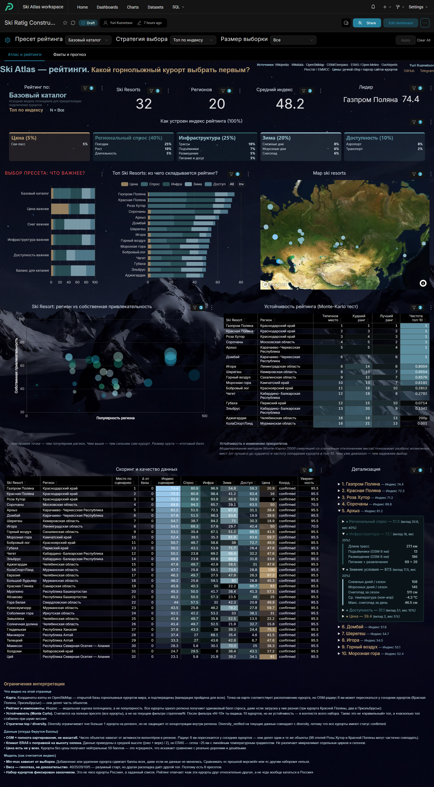
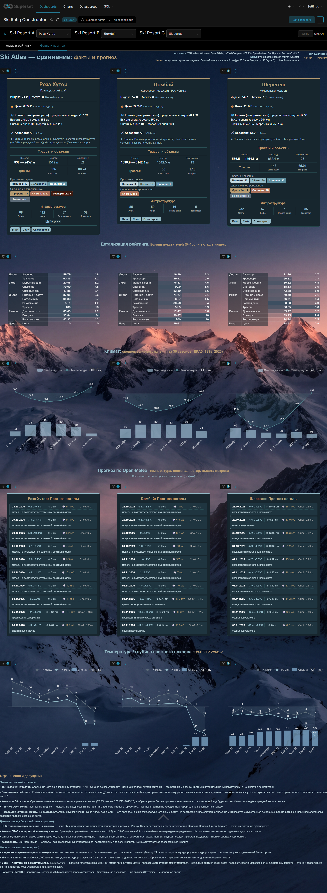
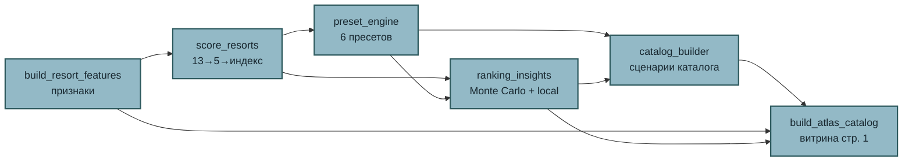
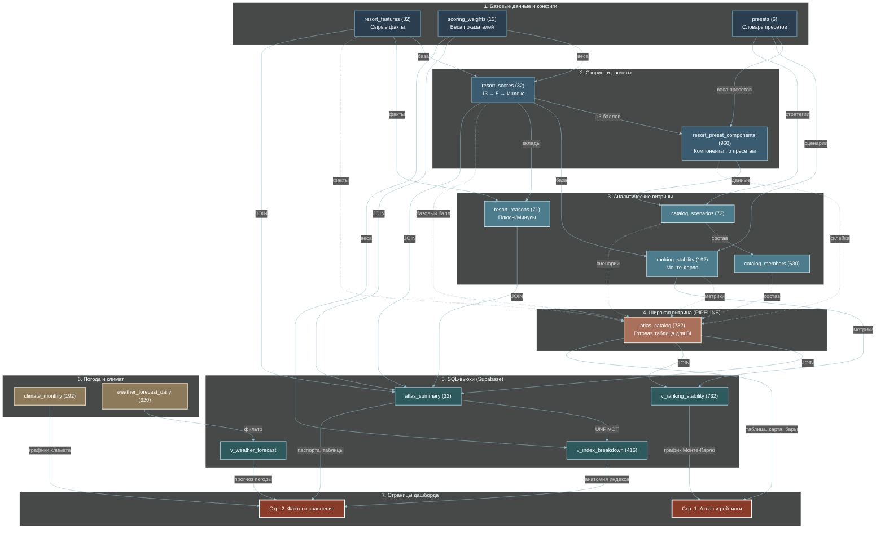
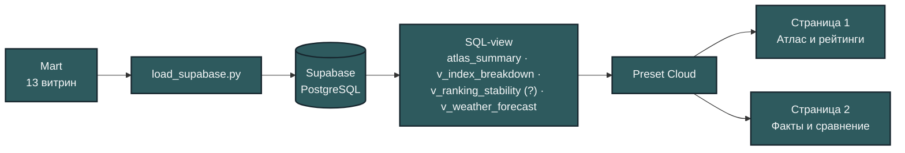
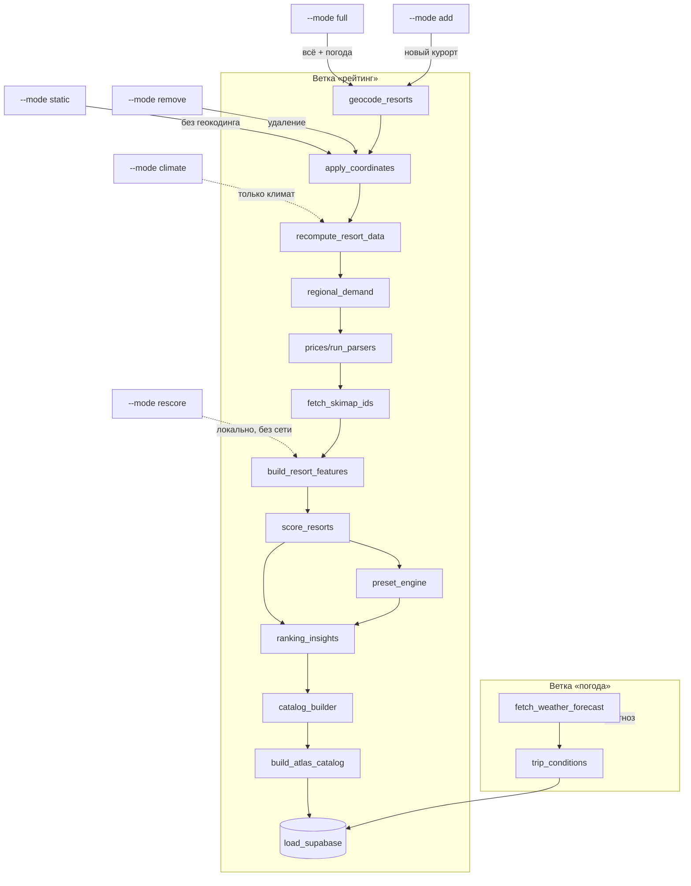

# SKI ATLAS (Travel Designer)

> Техническая «библия» проекта: архитектура данных, пайплайн, источники, витрины, методика и структура BI-дашборда.
> Единый источник правды по проекту — документация для аналитиков, разработчиков и дашборда.
>
---

## Скриншоты дашборда

### Страница 1 — «Атлас и рейтинги»



### Страница 2 — «Факты и прогноз»



---

## 1. Архитектура дашборда (Ski Atlas)

### Общее назначение

**Ski Atlas** — воспроизводимый композитный рейтинг **горнолыжных курортов** для приоритизации подключения к каталогу Travel Designer. Поскольку прямой сопоставимой статистики посещаемости по конкретным курортам в открытом доступе нет, рейтинг собирается из открытых источников: региональный турпоток, инфраструктура (OSM), климат (ERA5), аэропорт, цены.

**Ключевая идея:** не «правильный ответ», а **объяснимый и воспроизводимый инструмент** с прозрачными весами, ограничениями и оценкой уверенности в данных.

### Для кого

| Аудитория | Что получает |
|---|---|
| **Команда Travel Designer / продакт** | Приоритезация подключения курортов, обоснование решения, готовые сценарии каталога (N=5/8/10/12) |
| **Аналитик / разработчик** | Воспроизводимый расчёт: 13 показателей → 5 компонентов → индекс, оценка уверенности, устойчивость через Monte Carlo, drill-down до сырых фактов |
| **Лыжник / сноубордист** | Сравнение курортов по характеристикам, прогноз глубины снега и температуры на 10 дней, предпосылки состояния трасс |

### Общая архитектура данных

Пайплайн `run_pipeline.py` собирает данные из открытых источников в слои **RAW → Prepared → Mart** и загружает 13 витрин в Supabase. Дашборд работает на четырёх основных датасетах:

| Датасет | Гранулярность | Что содержит |
|---|---|---|
| `atlas_catalog` | курорт × сценарий (732 строки) | Все сценарии (6 пресетов × {all_top, all_diversity, top_nN, diversity_nN}), 5 компонентов + 5 вкладов + 5 весов + сырые факты |
| `atlas_summary` | курорт (32 строки) | Базовый срез (preset=base) + 13 сырых баллов + 13 вкладов + климат + ссылки + strengths/weaknesses |
| `v_index_breakdown` | курорт × показатель (416 строк) | Long-format разбивка индекса для stacked bar / treemap |
| `v_ranking_stability` | курорт × сценарий (732 строки) | `atlas_catalog` + метрики устойчивости из `ranking_stability` (median_rank, rank_p5/p95, top10_frequency, local_score) |

### Страница 1. «Атлас и рейтинги — какой горнолыжный курорт выбрать первым»

**Вопрос страницы:** какие курорты лидируют, за счёт чего, насколько устойчиво и насколько уверенно.

**Шапка:** заголовок «Ski Atlas: атлас и рейтинг»; источники (Wikipedia · Wikidata · OpenSkiMap · OSM/Overpass · ERA5 · Open-Meteo · OurAirports · Росстат/ЕМИСС · цены); индекс (модельная оценка потенциала, базовый каталог 40/25/20/10/5, 13 → 5 компонентов); контекстная панель (Handlebars) с пресетом, описанием, стратегией и N — обновляется с фильтрами.

**1. Карта 32 курортов** — «где находятся курорты». Цвет точки = индекс, размер = уверенность. Tooltip: название, регион, индекс, ссылки (официальный сайт / Вики / схема трасс). Видны кластеры: Краснодарский край (Роза Хутор, Красная Поляна, Газпром Поляна), Приэльбрусье (Эльбрус, Чегет), Мурманская область (Большой Вудъявр, Кукисвумчорр, КолаСпортЛэнд), Урал, Сибирь, Дальний Восток.

**2. KPI-карточки** — число курортов в сценарии, число регионов, курорты с ценой, средний индекс, доля с подтверждёнными координатами.

**2.5 «Выбор пресета: что важнее» (бары по пресетам)** — ключевой интерактивный элемент под KPI-карточками. 6 пресетов по Y, 100% ширины по X, внутри каждого бара 5 цветных сегментов (Спрос `#46767E`, Инфраструктура `#2E5A5E`, Зима `#93B9C6`, Доступность `#5E8FA0`, Цена `#B79B72`), ширина = вес компонента. Показывает, что «переключение пресета» — это другая расстановка приоритетов (в «Цена» цена 40% — и лидеры меняются: КолаСпортЛэнд, Евразия, Красная Глинка вместо Розы Хутор). Связан с таблицей скоринга — вклады в строке = проценты в баре.

**3. Горизонтальный рейтинг (топ-12)** — базовый рейтинг с разложением на 5 компонентов (stacked bar). Раскраска `label_colors`. Реагирует на пресет/стратегию/N.

**4. Пузырьковая диаграмма «влияние региона»** — X = региональный вклад, Y = индекс, размер = инфраструктурный балл. Видно «инфраструктурных лидеров в богатых регионах» vs «слабый регион + слабая инфраструктура».

**5. Monte Carlo устойчивости** — 5000 прогонов, шум ×U(0.6, 1.4) вокруг весов пресета, перенормировка к 100. Метрики `median_rank`, `rank_p5`, `rank_p95`, `top10_frequency`. Источник — `v_ranking_stability` (фильтруется по стратегии и N).

**6. Интерактивная таблица скоринга (Handlebars)** — drill-down «компонент → факты». Свёрнутый вид → 5 компонентов → факты (поездки/рост/ночёвки, трассы/подъёмники/размещение/питание, снег/мороз/снегопад/температура, аэропорт/транспорт, цена). Скролл `max-height:75vh; overflow-y:auto`. 5 цветных полос из `label_colors`. Реагирует на фильтры.

**7. Блок «Ограничения интерпретации»** — «Что видно» / «Данные» / «Модель» (координаты из OpenSkiMap с пересечением радиуса 6 км; индекс ≠ посещаемость, регион ≠ курорт; Monte Carlo на полном пресете; OSM = полнота картирования; ERA5 ~25 км с поправкой на высоту; цена не у всех — нейтральные 50; Min-max зависит от выборки; веса — гипотеза).

**Фильтры (native filters):**

| Фильтр | Поле | Значения | Что меняет |
|---|---|---|---|
| Пресет рейтинга | `preset_name_ru` | Базовый каталог / Баланс / Инфра / Снег / Доступ / Цена | Индекс и место по другой весовой схеме |
| Стратегия выбора | `strategy_name_ru` | Топ по индексу / Региональное разнообразие / Разнообразие + подтверждённые | Состав (top концентрируется, diversity ≤1 курорта на регион) |
| Размер выборки | `size_label` | 5 / 8 / 10 / 12 / Все | Сколько курортов показывать |

Default: Базовый каталог / Топ по индексу / Все → полный рейтинг 32 курортов по базовой модели.

### Страница 2. «Атлас сравнение — факты и прогноз»

**Вопрос страницы:** чем отличаются выбранные курорты, что проверить, стоит ли ехать.

**Шапка:** «Ski Atlas: сравнение и прогноз»; источники + Skimap (схемы трасс); индекс (базовый каталог 40/25/20/10/5 · 13 → 5 компонентов · сравнение по выбранным курортам).

**Фильтры:** Ski Resort A/B/C (`name_ru`), default Роза Хутор / Домбай / Шерегеш.

**1. Три карточки-паспорта курортов (Handlebars)** — название, регион, индекс, место; цена (₽) + тип продукта; климат (30-летняя норма); аэропорт (IATA + км); высоты (min/max, перепад) + длина трасс + подъёмники; сложность по категориям (цветные бейджи); инфраструктура OSM (отели/кафе/развлечения/транспорт); сноупарк/беговые (флаги); кнопки Вики/Сайт/Схема трасс.

**2. Три таблицы баллов - анатомия рейтинга** — 13 показателей → 5 компонентов → индекс, вклад и вес каждого; подсветка ячеек по значению (высокий/средний/низкий).

**3. Среднемесячный климат** — историческая норма 30 сезонов (ERA5, ноябрь–апрель), с поправкой на среднюю высоту склона ((низ + верх) / 2).

**4. Прогноз погоды 10 дней** — матрица «курорт × дата»: температура, осадки, снегопад, ветер (Open-Meteo Forecast API).

**5. «Температура / глубина снежного покрова. Ехать / не ехать»** — график на 10 дней: min/max температура, толщина снега (snow depth), снегопад по дням. Позволяет сравнить, где покров стабильно 80 см, а где 15 см с риском проталин. Ограничение: модельные предпосылки, не подтверждённое состояние трасс (оснежение, ратраки, лавины, ветер не учитываются).

**6. Ограничения и допущения** — «Что видно» / «Данные» / «Модель» (вклады = вес × балл, сумма ±0.1 из-за округления; климат — норма, не прогноз; точность прогноза падает с горизонтом; индекс ≠ посещаемость; Min-max зависит от выборки).

### Сквозная интерактивность

| Что | Как работает |
|---|---|
| Native filters | 3 фильтра на стр. 1 + 3 на стр. 2; по страницам независимы (фильтры стр. 1 не влияют на стр. 2) |
| Drill-down | Только в Handlebars-таблице скоринга (стр. 1): курорт → 5 компонентов → факты |
| Tooltip | Карта (ссылки), бары (значения), bubble (компоненты) |
| Cross-filter | Отключён (`cross_filters_enabled: false`) |
| CSS изоляция | CSS дашборда не проникает внутрь Handlebars — только inline-стили |

### Визуальная система

- Фон `#0a1418` (тёмный); палитра: бирюза `#93B9C6` (заголовки), золотой `#B79B72` (акценты/цена), 5 цветов компонентов (`label_colors`).
- Единая схема между чартами (`label_colors`) и Handlebars (inline `style`).

### Что показывает дашборд разным аудиториям

- **Команда Travel Designer:** какой курорт подключать первым (рейтинг + устойчивость + уверенность), что предложить покупателю (стр. 2, сравнение по фактам), какие данные подтянуть (блок «Ограничения»).
- **Аналитик/разработчик:** воспроизводимость (`--mode rescore`, бит-в-бит), прозрачность (13→5→индекс, веса в `scoring_weights.json`/`scoring_presets.json`), расширяемость (`resorts_manual.json`), drill-down = «живой отчёт».
- **Лыжник/сноубордист:** «где кататься» (стр. 2 карточки), «когда ехать» (климат + прогноз), «стоит ли ехать» (снегопад + толщина снега). Дашборд не учитывает оснежение, лавины, закрытие подъёмников, время трансфера — это честно указано в «Ограничениях».

### Технические детали реализации

| Что | Как |
|---|---|
| Хостинг дашборда | Preset Cloud, workspace `Urizen-Data`, план Starter |
| БД | Supabase PostgreSQL, `aws-0-eu-west-1.pooler.supabase.com` |
| CSS | `label_colors` в JSON Metadata + inline-стили в Handlebars + CSS дашборда для контейнеров |
| Пайплайн | `python run_pipeline.py --mode rescore` — пересчёт + загрузка в Supabase |
| Округление | 1 знак — баллы, 2 — ночей на поездку, 3 — рост, 0 — целые (поездки, ранги, OSM-объекты) |
| View устойчивости | `v_ranking_stability` = `atlas_catalog` ⋈ `ranking_stability` по `resort_id + preset_id` — фильтрует устойчивость по стратегии и N |

### Что НЕ обещает дашборд

- Фактическую посещаемость каждого курорта (только региональный прокси)
- Универсальный ответ «где лучше кататься» для любого человека
- Состояние открытых трасс и подъёмников в реальном времени
- Полный бюджет поездки, время трансфера по дороге
- Персональную рекомендацию по уровню катания

---

## 2. О проекте и продуктовые границы

**Цель:** рейтинг горнолыжных курортов России + данные для дашборда Travel Designer (платформа-конструктор поездок «ски-атлас»).

**Главный вопрос проекта:** какие горнолыжные курорты первыми включить в каталог Travel Designer и почему?

**Цепочка сторителлинга (User Journey):**
Дашборд должен провести пользователя по цепочке:
1. **Где** находятся курорты (Карта).
2. **Кто** лидирует в базовой модели (Рейтинг).
3. **За счёт чего** формируется результат (Вклады компонентов).
4. **Насколько** результат устойчив (Монте-Карло).
5. **Чем** отличаются выбранные варианты (Сравнение).
6. **Что** известно о сезоне и ближайших условиях (Климат и прогноз).
7. **Какой** стартовый каталог выбрать (Сценарии).

**Что проект НЕ обещает:**
- Фактическую посещаемость каждого курорта (в открытом доступе её нет).
- Универсальный ответ «где лучше кататься» для любого человека.
- Состояние открытых трасс и подъёмников в реальном времени.
- Полный бюджет поездки, время трансфера по дороге и лавинную безопасность.
- Персональную рекомендацию по уровню катания без специальных данных.

**Ключевые числа:**
- **32 курорта** в **20 регионах** России (список задан заказчиком — «Приложение В» ТЗ);
- **5 компонентов**, **13 нормированных показателей**;
- **13 витрин-датасетов** (CSV) в `data/mart/`, загружаемых в Supabase;
- **66 колонок** в `resort_features.csv` (сырые факты), **27 колонок** в `resort_scores.csv` (скоринг);
- **109 полей** в словаре `data/reference/field_dictionary.json`;
- **107 авто-тестов**.

**Происхождение данных.** Список курортов (`resorts_manual.json`: название + регион + нас.пункт + опц. координаты) задал заказчик. Всё остальное собирается скриптами из открытых источников: OpenSkiMap, Overpass/OSM, Wikidata, Skimap.org, Open-Meteo, OurAirports, Росстат/ЕМИСС.

---

## 3. Структура папок проекта

```text
Travel_Designer/
├── src/                        # исходный код пайплайна
│   ├── collect/                # сбор: координаты, OpenSkiMap, OSM, климат, прогноз, цены
│   │   ├── geocode_resorts.py         # координаты (каскад OpenSkiMap → Wikidata → Overpass)
│   │   ├── openskimap_client.py       # клиент OpenSkiMap (трассы, высоты, подъёмники)
│   │   ├── recompute_resort_data.py   # OSM-инфраструктура + трассы + климат + аэропорт
│   │   ├── fetch_skimap_ids.py        # ссылки details_url
│   │   ├── fetch_weather_forecast.py  # прогноз 10 дней
│   │   ├── manual_inputs.py           # единый ручной конфиг (load_resorts_manual, load_manual_prices, append/update/remove_resort)
│   │   └── prices/                    # парсеры цен (run_parsers, scrape_prices, sites, parsers/*)
│   ├── transform/              # трансформация: apply_coordinates, build_resort_features,
│   │                           #   regional_demand, regions
│   ├── scoring/                # скоринг: score_resorts (13→5→индекс), preset_engine
│   ├── analytics/              # аналитика: ranking_insights, catalog_builder,
│   │                           #   build_atlas_catalog, trip_conditions
│   ├── load/                   # загрузка: load_supabase
│   └── common/                 # утилиты: mart_io (чтение/запись витрин)
├── data/
│   ├── raw/                    # неизменяемые входы (seed, цены, Росстат) — от заказчика
│   ├── collected/              # сбор (координаты, прогноз) — генерируется
│   ├── prepared/               # объединённые (resorts.json, region_metrics, prices) — генерируется
│   ├── cache/                  # кэши (climate_daily, airports) — генерируется
│   ├── mart/                   # 13 витрин CSV (результат) — коммитится
│   └── reference/              # справочники: scoring_weights, scoring_presets,
│                               #   field_dictionary, region_key, views_backup.sql
├── docs/                       # документация: PROJECT_CONTEXT, DASHBOARD_*, DATA_GAPS
├── tests/                      # авто-тесты (pytest, 15 файлов)
├── notebooks/                  # Jupyter-ноутбуки анализа (01–04)
├── screenshots/                # скриншоты дашборда
├── run_pipeline.py             # оркестратор пайплайна (CLI: --mode ...)
├── requirements.txt            # зависимости
├── .gitignore                  # что не коммитится
└── README.md                   # этот документ
```

**Что не попадает в Git** (`.gitignore`): генерируемые слои `data/collected/`, `data/prepared/`, `data/cache/`; секреты `.env`; внутренний контекст `readme_context.md`; исходное ТЗ (`ТЗ/`); легаси-входы (`resort_open_data.json`, `climate_monthly.json` в `raw`). Витрины `data/mart/` и справочники `data/reference/` включены в репозиторий.
## 4. Data flow: обзор

Данные проходят пять стадий: **источники → сбор → хранение → аналитика → публикация**. Каждая стадия детально описана в разделах ниже; здесь — только общий контур.


## 5. Источники данных

Откуда берутся данные и какой скрипт их забирает:

| Источник | Что даёт | Скрипт сбора |
|---|---|---|
| **OpenSkiMap** | координаты skiArea, трассы, подъёмники, сложность, высоты | `geocode_resorts`, `recompute_resort_data` |
| **Wikidata** | Q-id, координаты P625, sitelink Wikipedia, P6400 (Skimap ID) | `geocode_resorts`, `fetch_skimap_ids` |
| **Overpass / OSM** | объекты в 6 км, теги `piste:*`, центроид | `geocode_resorts`, `recompute_resort_data` |
| **Skimap.org** | ID и ссылка на схему трасс | `fetch_skimap_ids` |
| **Wikipedia RU** | статья (fallback для ссылки) | `fetch_skimap_ids` |
| **Open-Meteo Archive** | климат ERA5, 30 сезонов | `recompute_resort_data` |
| **Open-Meteo Forecast** | прогноз 10 дней | `fetch_weather_forecast` |
| **OurAirports** | ближайший аэропорт | `recompute_resort_data` |
| **Росстат / ЕМИСС** | турпоток, ночёвки | `regional_demand` |
| **Сайты курортов** | цены ски-пассов | `prices/run_parsers` |
| **Nominatim** | валидация региона | `geocode_resorts` |

**Каскады и фолбэки:**
- **Координаты** (`geocode_resorts`): OpenSkiMap → Wikidata → центроид Overpass → ориентир заказчика; приоритет `openskimap > osm_centroid > wikidata`.
- **Ссылки `details_url`** (`fetch_skimap_ids`): Skimap → Wikipedia → Wikidata → NULL.
- **Цены** (`run_parsers`): `resorts_manual.json` (`manual` > `secondary`/`official`) > живые скраперы (Шерегеш, Кукисвумчорр, Гора Белая).

### Ключевые источники и фичи

**OpenSkiMap — источник точной геометрии курортов.** Открытие OpenSkiMap (отдельный слой OpenStreetMap для горнолыжных данных) закрыло главное «слепое пятно» проекта: раньше точных координат зоны катания и характеристик трасс не было. OpenSkiMap даёт:
- координаты зоны катания `skiArea` — приоритетный источник координат (`quality_new = openskimap`);
- протяжённость трасс `piste_length_km` и распределение по сложности (доли easy/intermediate/advanced);
- нижнюю и верхнюю высоты склона `piste_min_elevation_m` / `piste_max_elevation_m`, высоты подъёмников;
- каноничный `openskimap_id` и название курорта.

Overpass/OSM остаётся фолбэком для сложности трасс (если в OpenSkiMap данных нет) и единственным источником amenities (отели, кафе в радиусе 6 км).

**Климат и прогноз — по средней точке склона катания.** Ключевая фича, заметно изменившая оценки компонента «Зимние условия». Запрос к Open-Meteo (и исторический ERA5, и прогноз) идёт не по точке курорта у подножия, а по **средней высоте зоны катания**:

`elevation = (piste_min_elevation_m + piste_max_elevation_m) / 2` → поле `climate_elevation_m`.

Open-Meteo применяет температурный градиент (lapse rate), поэтому температуры и снегопады отражают реальную высоту катания, а не населённый пункт внизу. Для курортов с большим перепадом высот (например, Шерегеш: 577 → 1465 м, климат считается на ~1020 м) это даёт существенно иную картину снежных/морозных дней и снегопада, чем привязка к подножию, и меняет баллы компонента «Зимние условия».

Исторический климат — 30 зимних сезонов (ноябрь–апрель), кэш `data/cache/climate_daily.json` (докачиваются только недостающие сезоны — защита от лимита 429).

**Прогноз (10 дней) и предпосылки состояния трассы.** Прогноз Open-Meteo Forecast (горизонт 10 дней) складывается в `weather_forecast_daily`; `trip_conditions.py` превращает осадки, температуру и ветер в **предпосылки** состояния трассы — «пухляк», «накат», «каша», «лёд», «без снега» (это не фактическое состояние трассы, а модельная оценка — см. раздел «Ограничения»).

## 6. Сбор данных

Какой скрипт что делает и **в какой слой пишет**:

| Скрипт | Что делает | Пишет в слой |
|---|---|---|
| `geocode_resorts.py` | каскад координат + валидация региона | **Collected** |
| `apply_coordinates.py` | собирает справочник курортов | **Prepared** |
| `recompute_resort_data.py` | OSM-инфра + трассы + климат + аэропорт | **Prepared + Cache + Mart** |
| `regional_demand.py` | нормирует турпоток | **Prepared** |
| `prices/run_parsers.py` | цены (ручные → матрица → парсеры) | **Prepared** |
| `fetch_skimap_ids.py` | каскад ссылок | **Prepared** |
| `fetch_weather_forecast.py` | прогноз 10 дней | **Collected** |
| `trip_conditions.py` | эвристика состояния трассы | **Mart** |

**Инкрементальность и кэш:** климат докачивается (`cache/climate_daily.json`), аэропорты скачиваются один раз (`cache/airports.csv`), подтверждённые координаты не перегеокодируются (`KEEP_QUALITIES`). Троттлинг: Wikidata 0.6 с, Overpass 2.5 с; 3 зеркала Overpass с фолбэком.

## 7. Слои хранения

Где лежат данные, кто пишет и кто читает:

| Слой | Что лежит | Кто пишет | Кто читает |
|---|---|---|---|
| **RAW** | `resorts_manual.json` (курорты + цены + ссылки), `resorts.json` (эталон), `rosstat_*.csv` | вручную | `geocode_resorts`, `regional_demand`, `run_parsers` |
| **Collected** | `coordinates_*.json`, `weather_forecast.json` | `geocode_resorts`, `apply_coordinates`, `fetch_weather_forecast` | `apply_coordinates`, `trip_conditions` |
| **Prepared** | `resorts.json`, `region_metrics.json`, `prices.json` | `apply_coordinates`, `recompute_resort_data`, `regional_demand`, `run_parsers`, `fetch_skimap_ids` | `build_resort_features`, `fetch_weather_forecast` |
| **Cache** | `climate_daily.json`, `airports.csv` | `recompute_resort_data` | `recompute_resort_data` (инкремент) |
| **Mart** | 13 витрин CSV | `build_resort_features`, `score_resorts`, `preset_engine`, `ranking_insights`, `catalog_builder`, `build_atlas_catalog`, `trip_conditions`, `recompute_resort_data` | `load_supabase` → BI |
| **Reference** | `scoring_weights.json`, `scoring_presets.json`, `field_dictionary.json`, `region_key.json` | вручную | `score_resorts`, `preset_engine`, `ranking_insights` |

## 8. Аналитические модули

Как Prepared-данные превращаются в витрины. Порядок важен: каждый модуль читает выходы предыдущих.



| Модуль | Входы | Выходы |
|---|---|---|
| `build_resort_features` | Prepared (`resorts.json`, `region_metrics.json`, `prices.json`) | `resort_features.csv` |
| `score_resorts` | `resort_features.csv` + `scoring_weights.json` | `resort_scores.csv`, `scoring_weights.csv` |
| `preset_engine` | `resort_scores.csv` + `scoring_presets.json` | `presets.csv`, `resort_preset_components.csv` |
| `ranking_insights` | `resort_scores.csv` + `resort_features.csv` + `presets.csv` | `ranking_stability.csv`, `resort_components.csv`, `resort_reasons.csv` |
| `catalog_builder` | `resort_preset_components.csv` + `resort_features.csv` | `catalog_scenarios.csv`, `catalog_members.csv` |
| `build_atlas_catalog` | все mart + `ranking_stability` + `catalog_*` | `atlas_catalog.csv` |

## 9. Витрины Mart и архитектура данных

**Архитектура данных: от сырых фактов до интерактивного дашборда.** Схема иллюстрирует жизненный цикл данных в проекте. Главный принцип — разделение тяжелых вычислений и легкой визуализации. Пайплайн на Python собирает сырые факты (OSM, климат, цены) и производит сложный скоринг, упаковывая всё в единую широкую витрину `atlas_catalog`. Это позволяет дашборду на Первой странице работать быстрее, без сложных SQL-джойнов на лету. Аналитические SQL-вьюхи (например, `v_index_breakdown` и `atlas_summary`) собираются поверх готовых данных и служат источником для детальных сравнений, паспортов курортов и «анатомии индекса» на Второй странице.



### Назначение витрин (справочная таблица)

| Витрина (Датасет) | Строк | Назначение (и роль в пайплайне) | Где используется на дашборде |
|---|---|---|---|
| `atlas_catalog` | 732 | Главная широкая витрина BI. Собирается `build_atlas_catalog.py` из **`resort_preset_components` (pivot)** + `presets` + `resort_features` + `resort_scores` + `ranking_stability` + `scoring_weights` + `catalog_scenarios` + `catalog_members` | **Стр. 1** (Карта, Рейтинг, Пузырьки, KPI, Таблица скоринга, Детализация) · источник для view `atlas_summary` (Стр. 2) |
| `ranking_stability` | 192 | Устойчивость (Монте-Карло) + локальный рейтинг. Считается из `resort_scores` + `resort_features` + `presets`. Источник для `atlas_catalog` и view `v_ranking_stability` | **Стр. 1** (через view `v_ranking_stability`) |
| `resort_preset_components` | 960 | Скоринг по 6 пресетам (пресет × курорт × компонент). Источник для `atlas_catalog` (pivot) и `catalog_scenarios`/`catalog_members` (через `catalog_builder`) | (только на уровне пайплайна) |
| `presets` | 6 | Словарь 6 пресетов (id + название + 5 весов). Источник для `atlas_catalog`, `ranking_stability`, `resort_components`, `resort_reasons`, `catalog_*` | (только на уровне пайплайна) |
| `catalog_scenarios` | 72 | Готовые сценарии каталога. Источник для `atlas_catalog` | (только на уровне пайплайна) |
| `catalog_members` | 630 | Состав сценариев каталога. Источник для `atlas_catalog` | (только на уровне пайплайна) |
| `resort_scores` | 32 | Базовый скоринг (13→5→индекс). Источник для `atlas_catalog`, `presets`, `resort_preset_components`, `ranking_stability`, `resort_components`, `resort_reasons`, view `atlas_summary` | **Стр. 2** (через view `atlas_summary`) |
| `resort_features` | 32 | Сырые факты (трассы, цены, OSM, климат, аэропорт). Источник для `resort_scores`, `atlas_catalog`,view  `atlas_summary`, `resort_preset_components`, `catalog_*` | **Стр. 2** (через view `atlas_summary`) |
| `resort_components` | 160 | Компоненты (вклады) курорта — для проверки/drill-down. **Не** источник `atlas_catalog` | (только на уровне пайплайна) |
| `resort_reasons` | 71 | Текстовые объяснения (strength/weakness). Источник для `atlas_summary` | **Стр. 2** (через view `atlas_summary` в паспортах) |
| `scoring_weights` | 13 | Веса 13 показателей. Источник для `atlas_catalog`, view `atlas_summary`, `v_index_breakdown` | **Стр. 2** (через view `atlas_summary`/`v_index_breakdown` — детализация 13 показателей) |
| `climate_monthly` | 192 | Среднемесячный климат за 30 сезонов (ноябрь–апрель) | **Стр. 2** (графики исторического климата) |
| `weather_forecast_daily` | 320 | Прогноз 10 дней (курорт × дата) | **Стр. 2** (через view `v_weather_forecast` - прогноз, снежная глубина) |
| `atlas_summary` *(view)* | 32 | Базовый срез (preset=base). Собирается из `resort_features` + `atlas_catalog` + `resort_scores` + `scoring_weights` + `resort_reasons` | **Стр. 2** (паспорта, таблицы детализации) |
| `v_index_breakdown` *(view)* | 416 | Long-format разбивка индекса (UNPIVOT 13 показателей). Читает view `atlas_summary` + `scoring_weights` | stacked bar / treemap по 13 показателям |
| `v_ranking_stability` *(view)* | 732 | `atlas_catalog` + метрики устойчивости. JOIN `atlas_catalog` + `ranking_stability` по `resort_id + preset_id` | **Стр. 1** (график устойчивости Монте-Карло) |
| `v_weather_forecast` *(view)* | — | Читает `weather_forecast_daily` | **Стр. 2** (Handlebars-карточки, динамика прогноза погоды) |

## 10. Публикация в BI

Витрины Mart загружаются в Supabase, поверх них создаются SQL-view, а Preset Cloud отдаёт две страницы.




## 11. Методика скоринга (`score_resorts.py`)

13 показателей группируются в 5 компонентов. Веса в сумме дают 100.

| Компонент | Показатели | Вес |
|---|---|---|
| Региональный спрос | Поездки (25) + Рост (10) + Длительность (5) | **40** |
| Инфраструктура | Трассы (10) + Подъемники (7) + Размещение (5) + Инфраструктура (3) | **25** |
| Зимние условия | Снежные дни (8) + Морозные дни (6) + Снегопад (6) | **20** |
| Доступность | Аэропорт (8) + Транспорт (2) | **10** |
| Цена | Стоимость ски-пасса (5) | **5** |

Веса (и русские подписи) задаются в `data/reference/scoring_weights.json` и автоматически выгружаются в витрину `scoring_weights` (13 строк: показатель → компонент → вес), которая загружается в Supabase и доступна на дашборде. Изменили вес в конфиге → повторный прогон → дашборд показывает новые значения.

**Формулы:**
- **Min-max:** `100·(x−min)/(max−min)`
- **Log min-max:** Для поездок, OSM-объектов и снегопада (сглаживает выбросы).
- **Обратная:** `100 − log_min_max` для аэропорта и цены (чем меньше, тем лучше).
- **None (нет данных):** Дает нейтральные **50 баллов**.

**Индекс:** `popularity_score = Σ(балл × вес) / 100`.
**Уверенность:** `confidence_score` зависит от полноты данных (completeness), наличия цены и подтвержденных координат.

### Пресеты скоринга (сценарии приоритетов)

Веса вынесены в два конфига `data/reference/`:
- `scoring_weights.json` — 13 весов показателей + 5 весов компонентов (читает и валидирует `score_resorts.py`);
- `scoring_presets.json` — 6 пресетов (id + название + описание + 5 весов компонентов).

Движок `src/scoring/preset_engine.py` перевзвешивает **только 5 компонентных баллов** (не трогая 13 показателей и нормализацию):

```text
scenario_score = Σ component_score × component_weight_pct / 100
```

| Пресет | Спрос | Инфра | Зима | Доступ | Цена |
|---|--:|--:|--:|--:|--:|
| base — Базовый каталог | 40 | 25 | 20 | 10 | 5 |
| balance — Баланс для катания | 5 | 35 | 35 | 20 | 5 |
| infra — Инфраструктура важнее | 5 | 60 | 20 | 10 | 5 |
| snow — Снег важнее | 5 | 20 | 60 | 10 | 5 |
| access — Доступность важнее | 5 | 25 | 20 | 45 | 5 |
| price — Цена важнее | 5 | 20 | 20 | 15 | 40 |

Результат — две витрины: `presets.csv` (словарь) и `resort_preset_components.csv` (long: пресет × курорт × компонент = 960 строк). Базовый пресет `base` воспроизводит `popularity_score` (контрольная точка).

**Устойчивость и локальный рейтинг — тоже мультипресетные** (`ranking_insights.py`): `ranking_stability.csv` — **192 строки (32 курорта × 6 пресетов) × 11 колонок** (`resort_id, preset_id, preset_name_ru, name_ru, region, median_rank, rank_p5, rank_p95, top10_frequency, local_score, local_rank`). Для каждого пресета — Монте-Карло (5000 прогонов, seed 42, мультипликативный шум ×U(0.6, 1.4) вокруг весов ЭТОГО пресета, перенормировка к 100) → `median_rank`/`rank_p5`/`rank_p95`/`top10_frequency`; `local_score` = взвешенная сумма 4 нерегиональных компонентов (infra, winter, access, price) с весами пресета, перенормированная к 100% (regional не участвует); `local_rank` = место по `local_score` внутри пресета.

**Итоговая витрина страницы 1 — `atlas_catalog.csv`** (`build_atlas_catalog.py`): **732 строки × 86 колонок** = `all_top` (полный рейтинг, 192) + `all_diversity` (лучший курорт региона, ~120) + member-сценарии `top`/`diversity` (~420). Из `ranking_stability` в неё идут только `stability_median_rank` (переименованный `median_rank`), `local_score`, `local_rank` (мерж по `resort_id + preset_id`); `rank_p5`/`rank_p95`/`top10_frequency` остаются только в `ranking_stability` (стр. «Устойчивость рейтинга»).

---

## 12. Пайплайн и режимы (`run_pipeline.py`)

Оркестратор собирает шаги в правильном порядке и останавливается на первой ошибке.

### Состав цепочек

| Цепочка | Шаги |
|---|---|
| `RATING_FULL` | geocode → apply → recompute → regional_demand → prices → skimap_ids → build_features → score → preset_engine → ranking_insights → catalog → atlas_catalog |
| `RATING_STATIC` | apply → recompute → regional_demand → prices → skimap_ids → build_features → score → preset_engine → ranking_insights → catalog → atlas_catalog |
| `RATING_ADD` | как `RATING_FULL` (геокодинг новой точки + полный пересбор) |
| `WEATHER` | fetch_weather_forecast → trip_conditions |
| `CLIMATE` | recompute `--only-climate` → build_features → score → preset_engine → ranking_insights → catalog → atlas_catalog |
| `REMOVE` | apply_coordinates + `RATING_TAIL` (пересборка без удалённого курорта) |
| `RATING_RESCORE` | build_features → score → preset_engine → ranking_insights → catalog → atlas_catalog → load_supabase (локально, без сетевых запросов) |
| `LOAD` | load_supabase |

### Схема режимов пайплайна


### Флаги `run_pipeline.py`

| Флаг | Для чего |
|---|---|
| `--mode` | `{full, static, climate, weather, add, remove, rescore}` — обязательный выбор режима |
| `--force` | перегеокодировать координаты и пересобрать OSM заново (игнорировать инкрементальность) |
| `--no-load` | не загружать в Supabase (только локальные файлы) |
| `--skip-overpass-check` | не проверять доступность Overpass перед прогоном |
| `--name`, `--region`, `--settlement` | не-интерактивный ввод для `add`/`remove` |

**Флаги `recompute_resort_data.py`** (вызываются внутри цепочек):
*   `--only-climate`: только 30-летний климат (пропуск OpenSkiMap/OSM/аэропортов).
*   `--quality-only`: только производные поля качества.
*   `--piste-only`: только сложность/типы трасс.
*   `--force`: пересобрать статику заново.

### Ручное добавление курортов и цен (JSON-конфиги)

Вместо CLI (`--mode add`) управляйте курортами через **единый файл** `data/raw/resorts_manual.json` — единственный источник правды по курортам, ценам и ссылкам:

```json
{
  "resorts": [
    {
      "resort_id": "R033",
      "name_ru": "Новый Курорт",
      "region": "Республика Алтай",
      "settlement": "с. Телецкое",
      "lat": 51.7, "lon": 87.5,
      "official_website_url": "https://example.com",
      "details_url": null,
      "skimap_url": null,
      "prices": [
        {"month": null, "adult_price_min_rub": 3000, "adult_price_max_rub": 4500,
         "child_price_min_rub": null, "child_price_max_rub": null,
         "tariff_product": "Ски-пасс на 1 день", "coverage": null,
         "source_quality": "manual", "source_url": "https://example.com", "checked_at": "2026-09-14"}
      ]
    }
  ]
}
```

**Правила:**
*   `resort_id` — стабильный (R001…R032 уже заняты). Для нового курорта можно не указывать — `manual_inputs.py` выдаст следующий свободный (`R033`). Менять существующие ID нельзя.
*   `name_ru` и `region` обязательны; `settlement`, `lat`, `lon` — опциональны. Если заданы и `lat`, и `lon` — это точные координаты; иначе геокодинг.
*   `official_website_url`, `details_url`, `skimap_url` — вручную; если пусто — заполняются фолбэками (OpenSkiMap / `fetch_skimap_ids`).
*   `prices` — список цен: `month: null` = бессрочная, `"YYYY-MM"` = месячная. Приоритет `source_quality`: `manual` > `secondary`/`official` > живые парсеры. `checked_at` — `"YYYY-MM-DD"` или `null`.
*   Если цены нет нигде — нейтральные 50 баллов в скоринге.

**Итоговый сценарий:** вписываете курорт + цену + ссылки в `resorts_manual.json` → `python run_pipeline.py --mode static` → в дашборде появляется курорт с ценой и ссылками.

---

## 13. Сущности и контракт гранулярности (Для BI)

Это главный технический договор для Preset. Смешивание гранулярностей в одной широкой таблице без контроля кардинальности **запрещено**.

| Сущность (Датасет) | Одна строка означает | Уникальный ключ |
|---|---|---|
| `resort_features` | один курорт и его факты | `resort_id` |
| `resort_scores` | один курорт и его баллы | `resort_id` |
| `resort_components` | компонент курорта | `resort_id + component` |
| `ranking_stability` | устойчивость курорта в пресете | `resort_id + preset_id` |
| `resort_reasons` | одно объяснение курорта | `resort_id + reason_code` |
| `climate_monthly` | один месяц курорта | `resort_id + month` |
| `weather_forecast_daily` | одна дата прогноза курорта | `resort_id + date` |
| `catalog_scenarios` | один готовый сценарий | `scenario_id` |
| `catalog_members` | курорт внутри сценария | `scenario_id + resort_id` |
| `presets` | один пресет (словарь весов) | `preset_id` |
| `resort_preset_components` | компонент курорта в пресете | `preset_id + resort_id + component` |
| `atlas_catalog` | курорт в сценарии (широкая витрина стр. 1) | `scenario_id + resort_id + preset_id` |
| `scoring_weights` | один показатель модели (вес) | `indicator` |

**Правило:** Нельзя напрямую джойнить `climate_monthly` и `weather_forecast_daily` по одному `resort_id` — получится декартово произведение (размножение строк). Для Preset используются отдельные датасеты.

---

## 14. UX-правила и объяснимость в UI

Для каждой цифры в дашборде пользователь должен понимать, что это:
1. **Факт:** «расстояние до аэропорта по прямой — 35 км».
2. **Модельная оценка:** «высокий балл доступности по текущей нормализации».
3. **Ограничение:** «время трансфера по дороге не рассчитано».

**Запрещено использовать как готовые выводы:**
- «Лучший курорт» без уточнения критерия.
- «Подходит новичкам» по одной доле easy-сегментов.
- «Дешевле поездка» по одному ски-пассу.
- «Открыто» по прогнозу погоды.
- «Лёд» или «пухляк» как подтвержденное состояние трассы (только «предпосылки»).
- «Полная инфраструктура» по OSM-счетчикам.

---

## 15. Запуск и Troubleshooting

```powershell
python run_pipeline.py --mode full      # Полная пересборка
python run_pipeline.py --mode static    # Инкрементальный рейтинг
python run_pipeline.py --mode climate   # Только 30-летний климат
python run_pipeline.py --mode weather   # Только 10-дневный прогноз
python run_pipeline.py --mode add       # Добавить курорт
python run_pipeline.py --mode remove    # Удалить курорт
python run_pipeline.py --mode rescore            # пересчёт + загрузка в Supabase
python run_pipeline.py --mode rescore --no-load  # пересчёт без загрузки (для тестов)
```

**Troubleshooting Preset:**
При ошибке `SSL SYSCALL error` или `connection already closed` (Supabase закрывает спящие соединения), в настройках подключения (Advanced -> Other -> Engine Parameters) добавить:
`{"poolclass": "sqlalchemy.pool.NullPool", "pool_pre_ping": true}`.

**Требования:** Python 3.10+. Секреты Supabase и токены Mapbox хранятся строго в `.env` и не коммитятся в Git.

**Загрузка в Supabase (`load_supabase.py`):** пайплайн владеет только таблицами из `data/mart/*.csv` — колонки и ключи читаются из CSV (не хардкодятся). При неизменной схеме таблицы обновляются на месте (`CREATE TABLE IF NOT EXISTS` → очистка → вставка); при изменении схемы — пересоздаются (`DROP` + `CREATE`). VIEW (`atlas_summary`, `v_index_breakdown`, `v_weather_forecast`) создаются аналитиком в SQL Lab и пайплайном не трогаются. **Если на пересоздаваемую таблицу ссылаются VIEW — их нужно вручную дропнуть до загрузки и пересоздать после** (DDL вьюх держим в `data/reference/views_backup.sql`).

**Выборочная загрузка:** `load_supabase.py <таблицы...>` грузит только перечисленные таблицы (без аргументов — все). Режим `weather` грузит только `weather_forecast_daily` (погода ни от чего не зависит по FK). Остальные режимы грузят все 13: таблицы скоринга связаны внешними ключами с `climate_monthly`/`weather_forecast_daily` (через `resort_scores`), поэтому выборочная загрузка там сломала бы `DELETE`.

---

## 16. Ограничения и допущения

- **Индекс потенциала ≠ популярность**: оценка по открытым данным, а не фактическая посещаемость.
- **Региональный спрос** относится ко всему субъекту РФ, а не к конкретному курорту.
- **OSM/Overpass** отражает полноту картирования; сегменты трасс ≠ реальные трассы; соседние курорты могут пересекаться по радиусам 6 км.
- **Климат ERA5** — модельный (~25 км) и приведён к средней высоте склона (`elevation`); не заменяет метеостанцию на склоне.
- **Min-max нормализация** зависит от состава выборки: добавление/удаление курорта меняет баллы всех.
- **Геокодинг** «название + регион + settlement» надёжен для большинства, но неоднозначные названия уходят в `review`.
- **Цены** собраны не для всех курортов; без цены — нейтральные 50.
- **Лимит Open-Meteo Archive** — дневной: полный 30-летний сбор может потребовать нескольких запусков (инкрементальный кэш `climate_daily.json` это поддерживает).
- **rescore НЕ видит новых данных**: если появились новые курорты, цены, климат или ссылки — нужен `--mode static` или `--mode full`.
- **rescore идемпотентен**: на неизменённых входах даёт бит-в-бит тот же результат.
- **rescore всегда загружает результат в Supabase**; `--no-load` — только для тестов и CI.